# System Design Diagrams & UML Models
## CosmoStellarAtlas — Open Space Exploration Portal
**Author:** Rufus Samuel R  
**Registration Number:** URK25CS1090  
**Institution:** Karunya Institute of Technology and Sciences  
**Version:** 1.6.0 (Phase 8 Final Production Release)  
**Formal UML Models:** docs/diagrams/ (10 Formal Mermaid Model Sources)  

---

## 1. Use Case Model
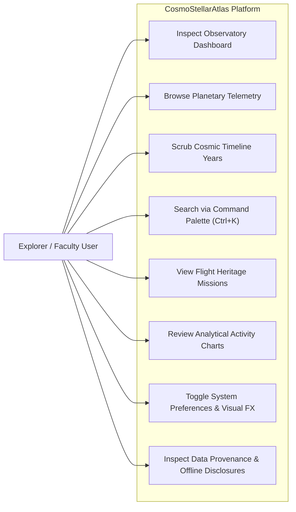

---

## 2. Component Diagram
```mermaid
graph TD
    subgraph UI_Shell["UI & Layout Shell"]
        AppLayout["AppLayout"]
        Navbar["Navbar HUD"]
        Sidebar["Sidebar Navigation Array"]
        Footer["Footer & Attribution"]
        Starfield["Starfield Canvas"]
        Palette["Command Palette"]
    end

    subgraph Feature_Views["Observatory Views"]
        Hero["HeroSection (Celestial Centerpiece)"]
        Stats["StatsSection (4 Metric Cards)"]
        PlanetFeat["FeaturedPlanetSection"]
        MissionFeat["MissionSpotlightSection"]
        TimelinePrev["TimelinePreviewSection"]
        ChartFeat["MissionActivityChartSection"]
        ModulesGrid["DiscoveryModulesSection"]
    end

    subgraph State_Layer["State Management"]
        AppStore["useAppStore (Zustand)"]
        LocalStorage[("Browser LocalStorage")]
    end

    subgraph Service_Layer["Service Abstraction"]
        ProviderInterface["<<interface>> SpaceDataProvider"]
        MockProvider["MockSpaceDataProvider"]
    end

    subgraph Data_Layer["Local Datasets"]
        PlanetsDB[("planetsData")]
        MissionsDB[("missionsData")]
        RoversDB[("roversData")]
        AsteroidsDB[("asteroidsData")]
        LaunchesDB[("launchesData")]
    end

    AppLayout --> Navbar
    AppLayout --> Sidebar
    AppLayout --> Footer
    AppLayout --> Feature_Views

    Feature_Views --> AppStore
    Feature_Views --> ProviderInterface
    AppStore <--> LocalStorage

    ProviderInterface <|.. MockProvider
    MockProvider --> Data_Layer
```

---

## 3. Activity Diagram: Dashboard Initialization & Year Scrubbing


---

## 4. Sequence Diagram: Data Fetching & Local Provider Flow
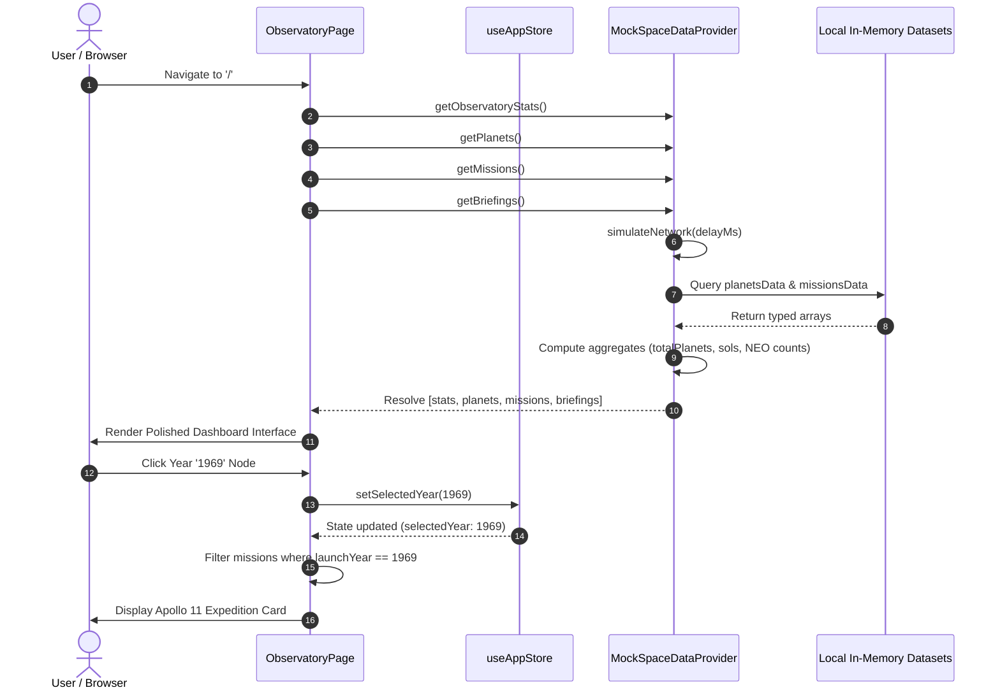

---

## 5. Entity Relationship Diagram (ERD)
```mermaid
erDiagram
    PLANET ||--o{ MISSION : "associated with"
    MISSION ||--|{ MISSION_MILESTONE : "contains"
    ROVER ||--|{ ROVER_IMAGE : "captures"
    PLANET {
        string id PK
        string name
        string codeName
        int orderFromSun
        string type
        float diameterKm
        float distanceFromSunAU
        float surfaceTempMeanC
        float gravityEarthRel
        int moonsCount
        string source
    }
    MISSION {
        string id PK
        string name
        string agency
        int launchYear
        string launchDate
        string status
        string destinationPlanetId FK
        string destinationName
        string missionType
        string description
        string source
    }
    MISSION_MILESTONE {
        string id PK
        string missionId FK
        int year
        string date
        string title
        string description
        string significance
    }
    ROVER {
        string id PK
        string name
        string agency
        string landingDate
        string landingSite
        string status
        int totalSols
        float distanceTraveledKm
        int sampleCount
        string source
    }
    ROVER_IMAGE {
        string id PK
        int sol
        string cameraName
        string cameraFullName
        string earthDate
        string caption
    }
    ASTEROID {
        string id PK
        string name
        string designation
        float estimatedDiameterMeters
        boolean isPotentiallyHazardous
        string closeApproachDate
        float missDistanceKm
        float relativeVelocityKmS
        string orbitClass
        float simulatedRiskIndex
        string source
    }

---

## 6. Use Case Model: Phase 2 Planet Explorer & Comparison Lab
```mermaid
flowchart LR
    User["Explorer / Astronomer"]

    subgraph PlanetExplorer["Planet Explorer Module (/planets)"]
        UC_View3D["Inspect 3D Planetary World (WebGL)"]
        UC_2DFallback["Switch to Accessible 2D Canvas Fallback"]
        UC_Controls["Manipulate Drag Rotation & Zoom Controls"]
        UC_NavMode["Toggle Explore vs Solar Schematic Mode"]
        UC_Weight["Calculate Interactive Relative Earth Weight"]
        UC_Compare["Compare Two Worlds Side-by-Side"]
        UC_Insights["Generate Deterministic Comparative Insights"]
        UC_Scale["Analyze Solar System Logarithmic Scales"]
        UC_Missions["Review Historical Planetary Missions"]
        UC_Epoch["Filter Missions via Cosmic Time Machine Epoch"]
        UC_Passport["Traverse via Discovery Passport Highlight"]
    end

    User --> UC_View3D
    User --> UC_2DFallback
    User --> UC_Controls
    User --> UC_NavMode
    User --> UC_Weight
    User --> UC_Compare
    User --> UC_Insights
    User --> UC_Scale
    User --> UC_Missions
    User --> UC_Epoch
    User --> UC_Passport
```

---

## 7. Sequence Diagram: Planet Selection & Rendering Pipeline
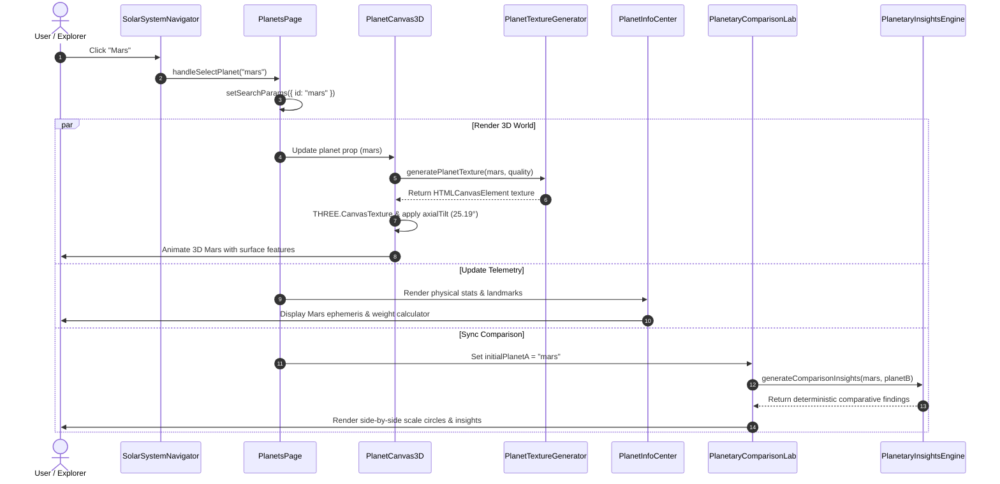

---

## 8. Activity Diagram: Planetary Comparison & Insights Synthesis
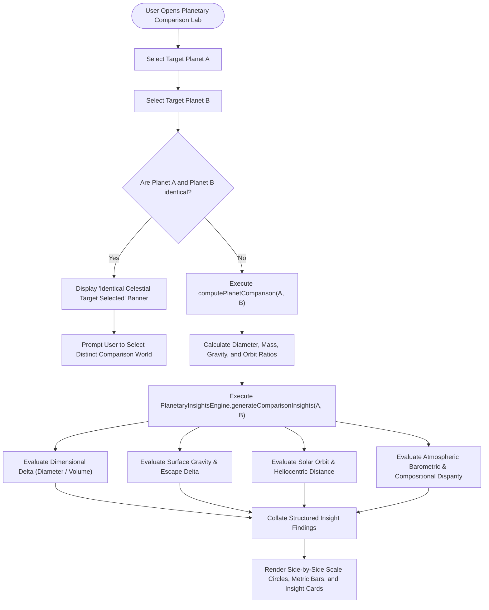

---


## 9. Use Case Model: Phase 3 Cosmic Time Machine & Mission Control
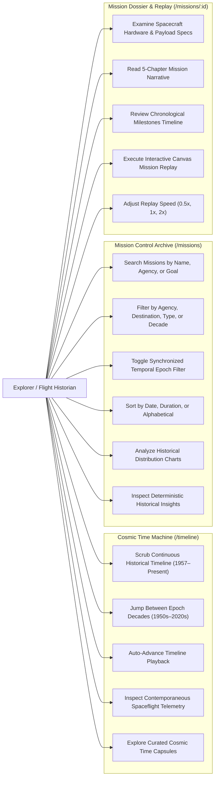

---

## 10. Activity Diagram: Cosmic Time Machine Scrubbing & Cross-Module Filtering
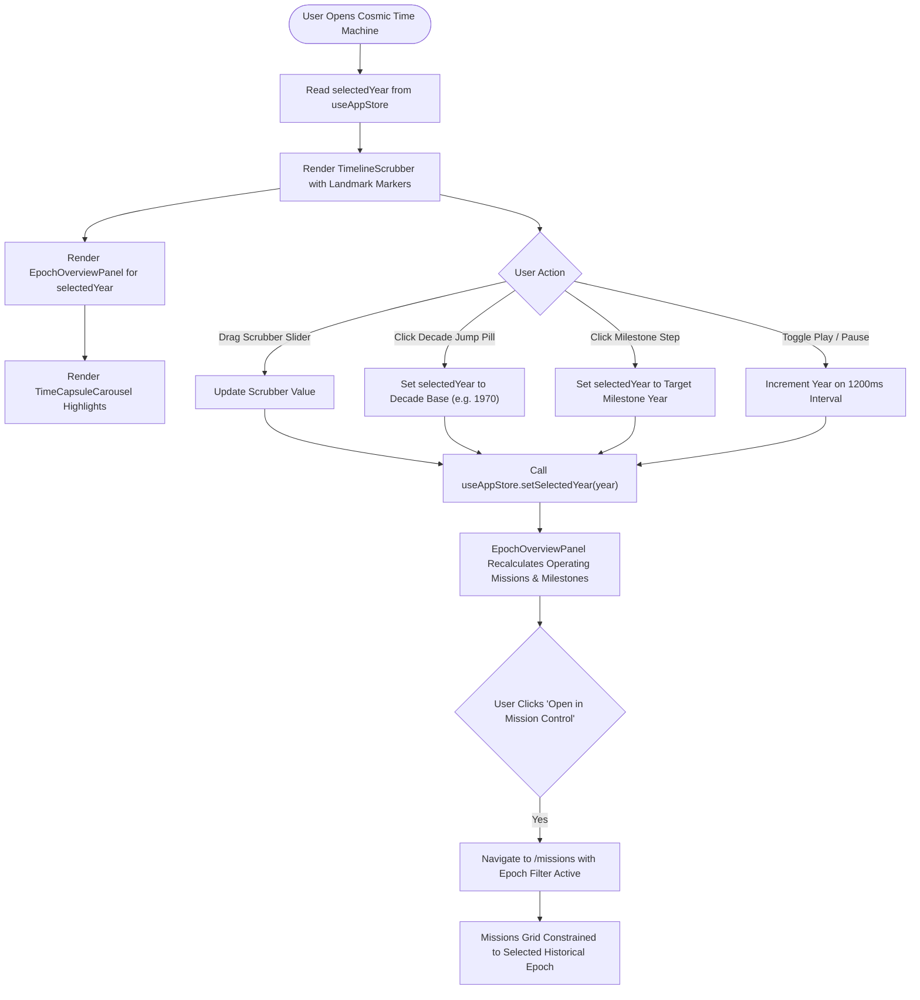

---

## 11. State Machine Diagram: Mission Replay Engine Lifecycle
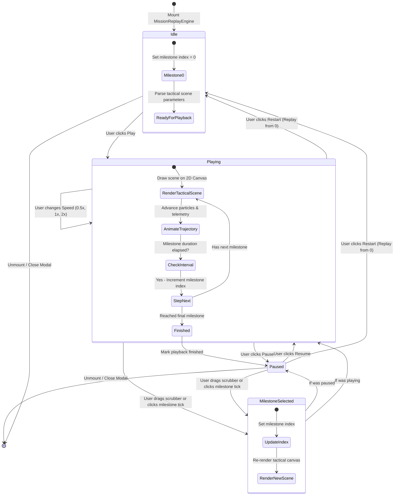

---

## 12. Sequence Diagram: Mission Archive Navigation & Replay Launch
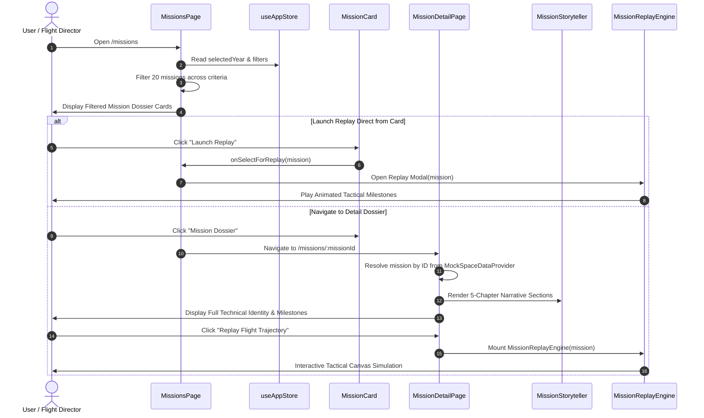

---

## 13. Component Diagram: Mission Control & Time Machine Subsystems
```mermaid
graph TD
    subgraph Routes["Application Routes"]
        R_Timeline["/timeline (TimelinePage)"]
        R_Missions["/missions (MissionsPage)"]
        R_Detail["/missions/:missionId (MissionDetailPage)"]
    end

    subgraph TimeMachine_Components["Time Machine Subsystem"]
        Scrubber["TimelineScrubber"]
        EpochPanel["EpochOverviewPanel"]
        CapsulesCarousel["TimeCapsuleCarousel"]
        CapsuleCard["TimeCapsuleCard"]
    end

    subgraph MissionControl_Components["Mission Control Subsystem"]
        MStats["Archive Summary Header"]
        MFilters["MissionFilters"]
        MAnalytics["MissionAnalyticsSection (Recharts)"]
        InsightsEngine["HistoricalInsightsEngine"]
        MGrid["MissionCard Array"]
    end

    subgraph Dossier_Components["Dossier & Replay Subsystem"]
        DossierHeader["Identity & Flight Heritage Header"]
        SpecsPanel["Spacecraft Technical Specs"]
        Storyteller["MissionStoryteller (5 Chapters)"]
        MilestonesList["Chronological Milestones Timeline"]
        ReplayEngine["MissionReplayEngine (Canvas)"]
    end

    subgraph Store_Service["Global Store & Services"]
        AppStore["useAppStore (Zustand)"]
        Provider["SpaceDataProvider (MockSpaceDataProvider)"]
        Datasets["missionsData & timeCapsulesData"]
    end

    R_Timeline --> Scrubber
    R_Timeline --> EpochPanel
    R_Timeline --> CapsulesCarousel
    CapsulesCarousel --> CapsuleCard

    R_Missions --> MStats
    R_Missions --> MFilters
    R_Missions --> MAnalytics
    MAnalytics --> InsightsEngine
    R_Missions --> MGrid
    R_Missions --> ReplayEngine

    R_Detail --> DossierHeader
    R_Detail --> SpecsPanel
    R_Detail --> Storyteller
    R_Detail --> MilestonesList
    R_Detail --> ReplayEngine

    Scrubber <--> AppStore
    EpochPanel --> Provider
    CapsulesCarousel --> Datasets
    MFilters <--> AppStore
    MGrid --> Provider
    DPage --> Provider
    Provider --> Datasets
```

---

## 14. Enriched Entity Relationship Diagram (ERD): Phase 3 Data Model
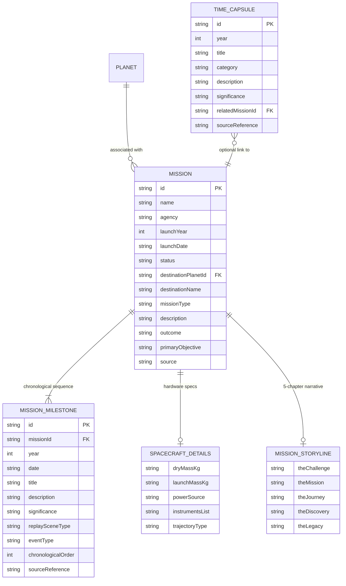


---

## 15. Use Case Model: Phase 4 Mars Rover Explorer & Operations Console
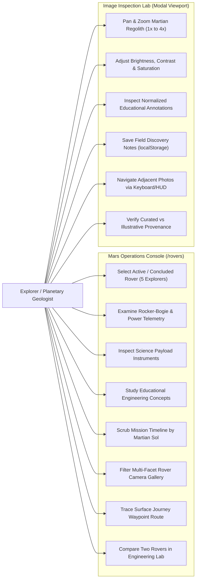

---

## 16. Activity Diagram: Rover Selection, Sol Scrubbing & Image Filtering Workflow
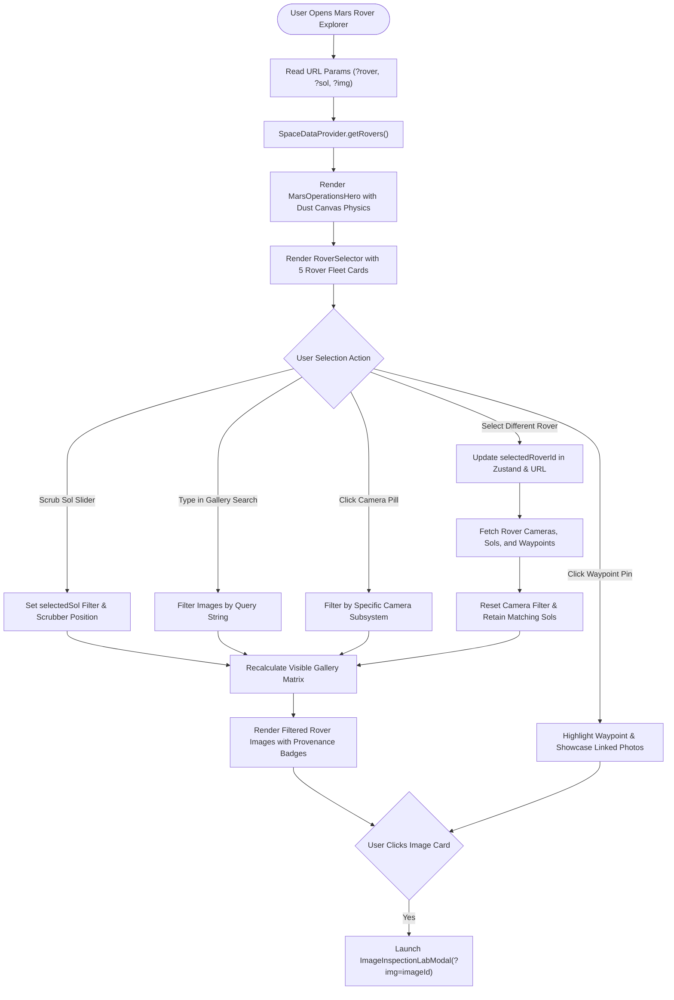

---

## 17. State Machine Diagram: Image Inspection Lab Viewport & Processing
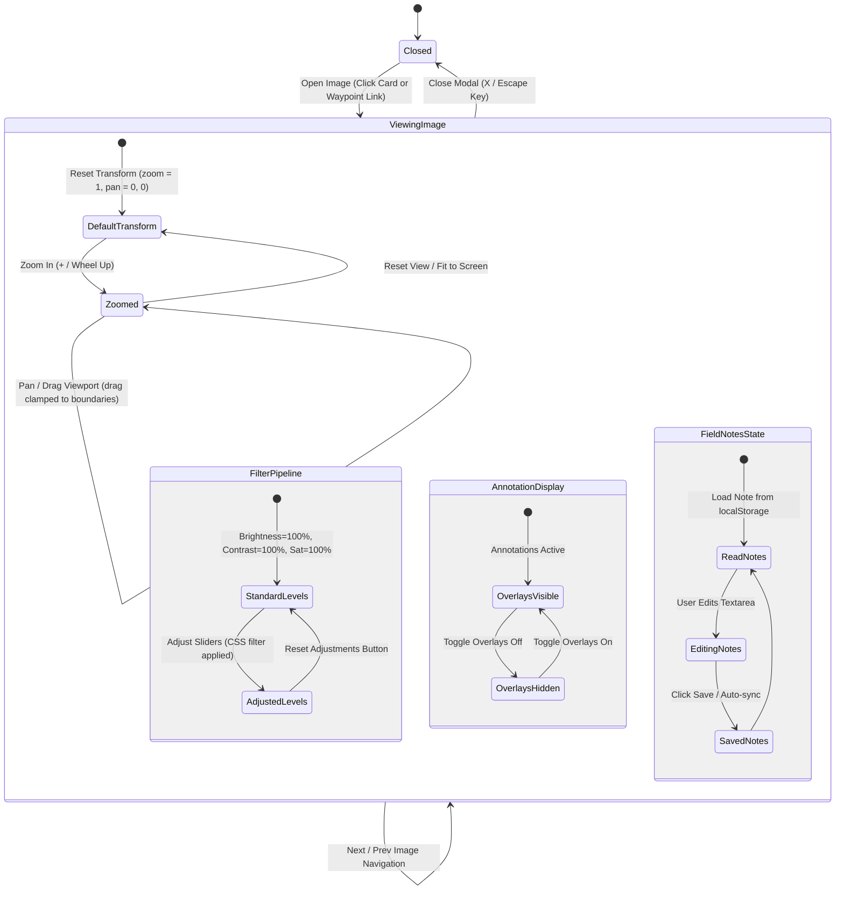

---

## 18. Sequence Diagram: Image Inspection & Educational Annotation Retrieval
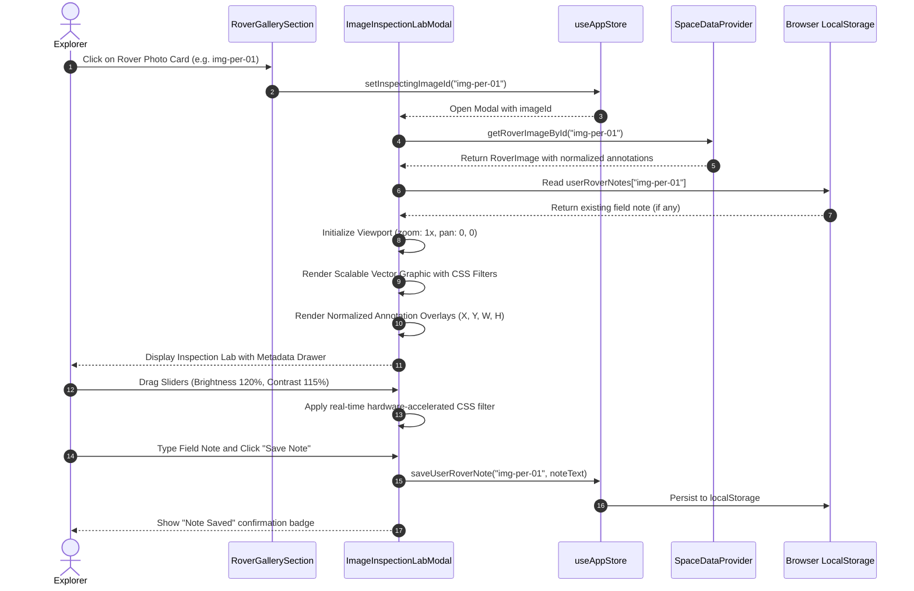

---

## 19. Component Diagram: Mars Rover Explorer Architecture
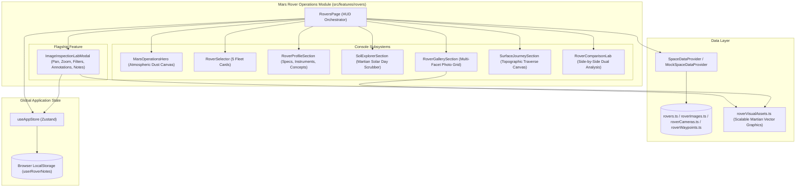

---

## 20. Updated Entity Relationship Diagram (ERD)
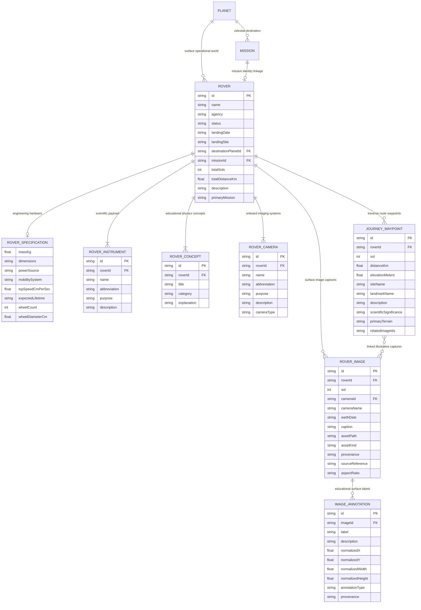

---

## 25. Phase 5 — Asteroid Watch & Planetary Defense Use Case Diagram
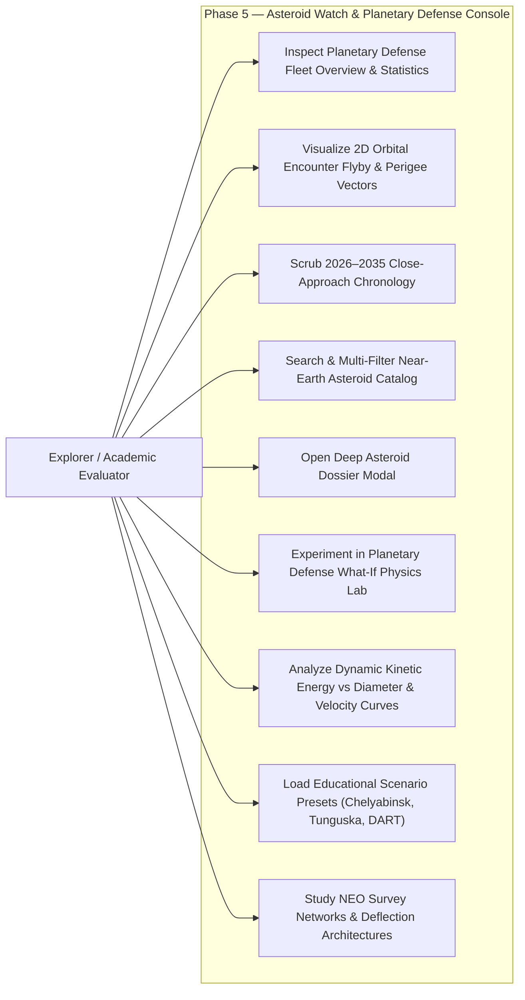

---

## 26. Phase 5 — Asteroid Selection & Filter Activity Diagram
```mermaid
flowchart TD
    Start([User navigates to Asteroid Watch /asteroids]) --> LoadData[Fetch 50 Asteroid Records via SpaceDataProvider]
    LoadData --> CheckURL{URL has ?id= parameter?}
    CheckURL -- Yes --> SetSelected[Set selectedAsteroidId in useAppStore]
    CheckURL -- No --> DefaultSelected[Default to first encounter record]
    SetSelected --> RenderView[Render Overview, Canvas, Timeline, Catalog, What-If Lab]
    DefaultSelected --> RenderView

    RenderView --> UserAction{User Interaction}
    UserAction -- Enter search query / change filters --> FilterMatrix[Apply Orbit, Category, Diameter, Dist, Vel filters]
    FilterMatrix --> SortMatrix[Sort by Closest, Largest, Fastest, Date]
    SortMatrix --> UpdateCatalog[Re-render Responsive Asteroid Card Deck]

    UserAction -- Click Asteroid Card --> UpdateStore[Update selectedAsteroidId & sync URL query]
    UpdateStore --> ReCenterCanvas[Center Trajectory on Orbital Radar Canvas]

    UserAction -- Click Inspect Details --> OpenModal[Mount AsteroidDetailModal with full specs]
    OpenModal --> ActionModal{User Action in Modal}
    ActionModal -- Close / Esc --> DismissModal[Unmount AsteroidDetailModal]
    ActionModal -- Click Test in What-If Lab --> MapParams[Convert diameter, velocity, density to simulation params]
    MapParams --> ScrollLab[Update whatIfParameters in store & smooth-scroll to #whatif]
```

---

## 27. Phase 5 — What-If Simulation Activity Diagram
```mermaid
flowchart TD
    InitSim([What-If Lab Active]) --> ReadParams[Read SimulationParameters: d, v, rho, missDistance]
    ReadParams --> Validate[Validate & Clamp: d in 10..1000m, v in 5..40km/s, rho in 1000..3500kg/m3]
    
    Validate --> Step1[Step 1: Calculate radius r = d / 2]
    Step1 --> Step2[Step 2: Calculate spherical volume V = 4/3 * pi * r^3]
    Step2 --> Step3[Step 3: Calculate mass m = rho * V in kg]
    Step3 --> Step4[Step 4: Convert velocity v_ms = v_kms * 1000]
    Step4 --> Step5[Step 5: Calculate kinetic energy E = 1/2 * m * v_ms^2 in Joules]
    Step5 --> Step6[Step 6: Convert to TNT equivalents: kt = E / 4.184e12, Mt = E / 4.184e15]

    Step6 --> DecoupleCheck{Miss Distance changed?}
    DecoupleCheck -- Yes --> UpdateCanvasOnly[Update 2D Canvas perigee display without altering E]
    DecoupleCheck -- No --> ContinueSim[Proceed to sensitivity analysis]
    UpdateCanvasOnly --> ContinueSim

    ContinueSim --> CalcSensitivity[Compute Sensitivity Multipliers: d*2 -> 8x, v*2 -> 4x, rho*2 -> 2x]
    CalcSensitivity --> GenCurves[Generate Recharts points: Energy vs Diameter & Energy vs Velocity]
    GenCurves --> GenInsights[Generate Explainable Physics Insights & Disclosures]
    GenInsights --> RenderKPI[Render Live Metric Cards, Recharts Curves, and Narrative Dossiers]
```

---

## 28. Phase 5 — Physics Calculation Sequence Diagram
```mermaid
sequenceDiagram
    autonumber
    actor User as Student / Evaluator
    participant Lab as PlanetaryDefenseWhatIfLab
    participant Store as useAppStore
    participant Math as planetaryDefenseMath.ts
    participant Recharts as Recharts Visualization Engine

    User->>Lab: Adjust Diameter Slider (e.g., 100m -> 200m)
    Lab->>Store: setWhatIfParameters({ diameterM: 200 })
    Store-->>Lab: Updated whatIfParameters state
    
    Lab->>Math: calculateSimulationResult(parameters)
    Math->>Math: calculateImpactRadius(200) -> 100m
    Math->>Math: calculateSphereVolume(100) -> 4,188,790 m³
    Math->>Math: calculateAsteroidMass(V, 2500) -> 10,471,975,512 kg
    Math->>Math: convertVelocityKmSToMs(20) -> 20,000 m/s
    Math->>Math: calculateKineticEnergy(m, 20,000) -> 2.094e18 Joules
    Math->>Math: convertJoulesToMegatonsTNT(E) -> ~500.5 Mt
    Math-->>Lab: SimulationResult { volume, mass, energyJ, megatons }

    Lab->>Math: generateEnergyVsDiameterCurve(velocity, density)
    Math-->>Lab: 20 curve coordinates [{ diameterM, energyMegatons }]

    Lab->>Math: generateSensitivityBreakdown(parameters)
    Math-->>Lab: SensitivityComparison[] (8x, 4x, 2x)

    Lab->>Recharts: Render LineChart with ReferenceDot at active parameter
    Lab-->>User: Display updated KPI Cards, Megatons, and Explainable Insights
```

---

## 29. Phase 5 — Asteroid Watch Component Diagram
```mermaid
graph TD
    subgraph Route_Page["Container Route (/asteroids)"]
        AsteroidsPage["AsteroidsPage"]
        QuickLinks["Quick-Link Anchor Bar (#radar, #timeline, #catalog, #whatif)"]
    end

    subgraph Feature_Components["Asteroid Feature Components"]
        Hero["AsteroidWatchHero (Earth Canvas & Fleet Stats)"]
        Canvas["OrbitalEncounterCanvas (2D Keplerian Trajectory HUD)"]
        Timeline["CloseApproachTimeline (Chronology Scrubber)"]
        Catalog["AsteroidExplorerSection (Search & Multi-Facet Filters)"]
        DetailModal["AsteroidDetailModal (Physical Specs & CTA)"]
        WhatIf["PlanetaryDefenseWhatIfLab (Physics Sliders & Charts)"]
        Education["PlanetaryDefenseEducationPanel (Taxonomy & Mitigation)"]
    end

    subgraph Math_Lib["Pure Scientific Engine"]
        DefenseMath["planetaryDefenseMath.ts"]
        SensCalc["Sensitivity & Curve Generators"]
        InsightsEngine["Explainable Physics Narrative Engine"]
    end

    subgraph Service_State["State & Data Service"]
        AppStore["useAppStore (Zustand: selectedAsteroidId, whatIfParameters)"]
        SpaceService["SpaceDataProvider (MockSpaceDataProvider)"]
        AsteroidData[("asteroids.ts (50 records)")]
    end

    AsteroidsPage --> QuickLinks
    AsteroidsPage --> Hero
    AsteroidsPage --> Canvas
    AsteroidsPage --> Timeline
    AsteroidsPage --> Catalog
    AsteroidsPage --> DetailModal
    AsteroidsPage --> WhatIf
    AsteroidsPage --> Education

    WhatIf --> DefenseMath
    WhatIf --> SensCalc
    WhatIf --> InsightsEngine

    AsteroidsPage --> AppStore
    AsteroidsPage --> SpaceService
    SpaceService --> AsteroidData
```

---

## 30. Phase 5 — Updated Entity-Relationship Diagram (ERD)
```mermaid
erDiagram
    ASTEROID ||--o{ SIMULATION_PARAMETERS : "transfers to"
    SIMULATION_PARAMETERS ||--|| SIMULATION_RESULT : "evaluates to"
    EDUCATIONAL_SCENARIO ||--|| SIMULATION_PARAMETERS : "presets"

    ASTEROID {
        string id PK
        string name
        string designation
        int estimatedDiameterMeters
        int estimatedDiameterMinM
        int estimatedDiameterMaxM
        int estimatedDiameterMeanM
        boolean isPotentiallyHazardous
        string closeApproachDate
        float missDistanceKm
        float missDistanceLunar
        float relativeVelocityKmS
        string orbitClass
        float simulatedRiskIndex
        string composition
        string estimatedComposition
        string syntheticCategory
        string observationCategory
        string syntheticClassification
        string scenarioDescription
        string educationalNotes
        string dataStatus
        string datasetReferenceDate
        string source
    }

    SIMULATION_PARAMETERS {
        float diameterM
        float velocityKmS
        float densityKgM3
        float illustrativeMissDistanceKm
    }

    SIMULATION_RESULT {
        float radiusM
        float volumeM3
        float massKg
        float velocityMs
        float kineticEnergyJ
        float kineticEnergyKilotons
        float kineticEnergyMegatons
    }

    EDUCATIONAL_SCENARIO {
        string id PK
        string name
        string subtitle
        string description
        string historicalReference
        string assumptions
        string educationalSignificance
    }

---

## 31. Phase 6 — Use Case Diagram: Cosmo Intelligence & Smart Discovery
```mermaid
flowchart TD
    User([Astronomy Student / Researcher / Faculty])

    subgraph Platform_Intelligence["Space Intelligence & Smart Discovery Subsystems"]
        UC1(["Explore Subsystems via Anchor Bar"])
        UC2(["Read Autonomous Cosmic Briefings"])
        UC3(["Synchronize Historical Briefing with Year Slider"])
        UC4(["Ask the Atlas Deterministic Query Assistant"])
        UC5(["Execute Universal Smart Token Search"])
        UC6(["Filter Search by Entity Type"])
        UC7(["Launch Global Command Palette (Ctrl+K)"])
        UC8(["Inspect 2D Cosmic Discovery Graph"])
        UC9(["Focus 1-Hop Neighborhood Subgraph"])
        UC10(["Toggle Accessible Relational List View"])
        UC11(["Review Explainable Recommendations & Rationales"])
        UC12(["Audit Algorithm Rules & Ephemeris Evidence"])
    end

    User --> UC1
    User --> UC2
    User --> UC3
    User --> UC4
    User --> UC5
    User --> UC6
    User --> UC7
    User --> UC8
    User --> UC9
    User --> UC10
    User --> UC11
    User --> UC12
```

---

## 32. Phase 6 — Universal Search Activity Diagram
```mermaid
flowchart TD
    Start([User Types in Search Bar or Command Palette]) --> Tokenize["Normalize Query & Split Tokens"]
    Tokenize --> ReadCatalog["Load In-Memory Inverted Search Catalog"]
    ReadCatalog --> FilterType{"Is Entity Filter Active?"}
    FilterType -- Yes --> FilterItems["Discard items not matching type"]
    FilterType -- No --> IterItems["Evaluate each catalog item"]
    FilterItems --> IterItems

    IterItems --> ExactMatch{"Exact Title Match?"}
    ExactMatch -- Yes --> Add50["Score += 50 pts (exact_title)"]
    ExactMatch -- No --> PrefixMatch{"Title Starts With Query?"}
    PrefixMatch -- Yes --> Add30["Score += 30 pts (title_prefix)"]
    PrefixMatch -- No --> TokenLoop["Evaluate individual tokens"]

    Add50 --> TokenLoop
    Add30 --> TokenLoop

    TokenLoop --> FieldScan["Title (+20), Subtitle (+10), Description (+5)"]
    FieldScan --> ConjCheck{"Do all query tokens match?"}
    ConjCheck -- Yes (k > 1) --> Add15["Score += 15 pts (conjunction bonus)"]
    ConjCheck -- No --> Accumulate["Sum total score"]
    Add15 --> Accumulate

    Accumulate --> FilterZero{"Score > 0?"}
    FilterZero -- Yes --> Collect["Push to scoredResults array"]
    FilterZero -- No --> Skip["Omit item"]

    Collect --> HasMore{"More items?"}
    Skip --> HasMore
    HasMore -- Yes --> IterItems
    HasMore -- No --> Sort["Sort scoredResults DESC by relevanceScore"]
    Sort --> Slice["Slice top N results (e.g. 12 hits)"]
    Slice --> Render["Render Result Cards with Working Routes"]
    Render --> End([Display in UI / Command Palette])
```

---

## 33. Phase 6 — Query Intent Processing Activity Diagram
```mermaid
flowchart TD
    Input([User Enters Natural Query]) --> Norm["Normalize: lowercase, strip punctuation, trim"]
    Norm --> ExtractEntities["Extract Entities: Planets, Rovers, Asteroids, Missions, Year"]
    ExtractEntities --> IntentCheck{"Evaluate Syntactic Patterns"}

    IntentCheck -- "Overview keyword" --> I_Overview["Intent: general_overview"]
    IntentCheck -- "Distance units (LD/AU)" --> I_Dist["Intent: asteroid_explain_distance"]
    IntentCheck -- "Closest approach" --> I_Closest["Intent: asteroid_closest"]
    IntentCheck -- "Hazardous / PHA" --> I_Hazard["Intent: asteroid_filter"]
    IntentCheck -- "Photos / Camera" --> I_Photos["Intent: rover_images"]
    IntentCheck -- "List rovers" --> I_RList["Intent: rover_list"]
    IntentCheck -- "Two planets / Compare" --> I_Compare["Intent: planet_comparison"]
    IntentCheck -- "Superlatives (hottest, largest)" --> I_Extreme["Intent: planet_extreme"]
    IntentCheck -- "Four-digit year + mission" --> I_Epoch["Intent: mission_epoch"]
    IntentCheck -- "Destination + mission" --> I_Dest["Intent: mission_destination"]
    IntentCheck -- "Specific rover" --> I_Rover["Intent: rover_info"]
    IntentCheck -- "Specific mission" --> I_Mission["Intent: mission_info"]
    IntentCheck -- "Specific planet" --> I_Planet["Intent: planet_info"]
    IntentCheck -- "Entity without question" --> I_Suggest["Intent: entity_suggestion"]
    IntentCheck -- "No match" --> I_Unknown["Intent: unknown"]

    I_Overview --> Exec["queryExecutionService: Generate Factual Response"]
    I_Dist --> Exec
    I_Closest --> Exec
    I_Hazard --> Exec
    I_Photos --> Exec
    I_RList --> Exec
    I_Compare --> Exec
    I_Extreme --> Exec
    I_Epoch --> Exec
    I_Dest --> Exec
    I_Rover --> Exec
    I_Mission --> Exec
    I_Planet --> Exec
    I_Suggest --> Exec
    I_Unknown --> Exec

    Exec --> Format["Synthesize Markdown, Sources, Follow-ups, Audit Evidence"]
    Format --> Output([Render in Ask-the-Atlas Assistant])
```

---

## 34. Phase 6 — Natural Language Query Assistant Sequence Diagram
```mermaid
sequenceDiagram
    autonumber
    actor User as Astronomy Student
    participant AskSection as AskTheAtlasSection
    participant ExecService as queryExecutionService
    participant Parser as queryIntentParser
    participant Datasets as Local Data (Planets/Missions/Rovers/Asteroids)
    participant EvidencePanel as InsightEvidencePanel

    User->>AskSection: Enter query "What is Mars?" or click suggestion pill
    AskSection->>ExecService: executeQuery("What is Mars?")
    ExecService->>Parser: parse("What is Mars?")
    Parser->>Parser: extractEntities("what is mars") -> [Planet: mars]
    Parser-->>ExecService: QueryIntent(type: planet_info, confidence: 0.90)
    ExecService->>Datasets: Retrieve ephemeris record for "mars"
    Datasets-->>ExecService: Physical specs, atmosphere, features
    ExecService->>ExecService: Format markdown table, source references, follow-ups
    ExecService-->>AskSection: QueryResponse(answer, sources, follow-ups, evidenceExplanation)
    AskSection->>User: Display structured factsheet and verified sources

    opt Inspect Algorithmic Proof
        User->>AskSection: Click "Audit Rule Logic"
        AskSection->>EvidencePanel: onInspectEvidence(response)
        EvidencePanel->>User: Scroll to Evidence Panel & display rules applied
    end
```

---

## 35. Phase 6 — Cosmic Briefing Generation Sequence Diagram
```mermaid
sequenceDiagram
    autonumber
    actor User as Researcher
    participant BriefingSection as CosmicBriefingSection
    participant AppStore as useAppStore
    participant BriefingService as briefingGeneratorService
    participant MissionsData as missionsData

    User->>BriefingSection: Select "Historical Exploration" tab
    BriefingSection->>AppStore: Read selectedYear (e.g. 1969)
    BriefingSection->>BriefingService: generateBriefing('historical_exploration', 1969)
    BriefingService->>MissionsData: Filter missions launched in 1969
    MissionsData-->>BriefingService: [Apollo 11, Mariner 6, Mariner 7]
    BriefingService->>BriefingService: Synthesize year-specific dossier & takeaways
    BriefingService-->>BriefingSection: GeneratedBriefing(title, summary, highlights, CTA)
    BriefingSection->>User: Display Year 1969 Briefing

    opt Scrub Historical Epoch Slider
        User->>BriefingSection: Drag slider to year 1977
        BriefingSection->>AppStore: setSelectedYear(1977)
        BriefingSection->>BriefingService: generateBriefing('historical_exploration', 1977)
        BriefingService->>MissionsData: Filter missions launched in 1977
        MissionsData-->>BriefingService: [Voyager 1, Voyager 2]
        BriefingService-->>BriefingSection: GeneratedBriefing for Voyager epoch
        BriefingSection->>User: Dynamically refresh briefing card to 1977
    end
```

---

## 36. Phase 6 — Space Intelligence Subsystem Component Diagram
```mermaid
graph TD
    subgraph Route_Page["Container Route (/intelligence)"]
        IntelligencePage["IntelligencePage"]
        Hero["CosmoIntelligenceHero (Metrics & Subsystem Jump Bar)"]
    end

    subgraph Subsystem_Sections["Intelligence Feature Sections"]
        BriefingSec["CosmicBriefingSection (5 Categories & Year Scrubber)"]
        AskAtlasSec["AskTheAtlasSection (Deterministic Assistant)"]
        SearchSec["UniversalSearchSection (Token Inverted Index)"]
        GraphSec["CosmicDiscoveryGraphSection (2D SVG & Accessible List)"]
        RecsSec["ExplainableRecommendationsSection (Contextual Matrix)"]
        EvidenceSec["InsightEvidencePanel (Algorithmic Proof Audit)"]
    end

    subgraph Service_Layer["Pure Deterministic Services"]
        BriefingServ["briefingGeneratorService.ts"]
        IntentParser["queryIntentParser.ts"]
        QueryExec["queryExecutionService.ts"]
        SearchIndex["searchIndexService.ts"]
        GraphServ["discoveryGraphService.ts"]
        RecsEngine["recommendationEngineService.ts"]
        EvidenceServ["evidenceExplanationService.ts"]
    end

    subgraph Global_State["Shared State & Data Store"]
        Zustand["useAppStore (selectedYear, selectedPlanetId, etc.)"]
        CommandPaletteComp["CommandPalette.tsx (Global Ctrl+K)"]
        CuratedData[("Curated Scientific Datasets (Planets, Missions, Rovers, Asteroids)")]
    end

    IntelligencePage --> Hero
    IntelligencePage --> BriefingSec
    IntelligencePage --> AskAtlasSec
    IntelligencePage --> SearchSec
    IntelligencePage --> GraphSec
    IntelligencePage --> RecsSec
    IntelligencePage --> EvidenceSec

    BriefingSec --> BriefingServ
    AskAtlasSec --> QueryExec
    QueryExec --> IntentParser
    SearchSec --> SearchIndex
    CommandPaletteComp --> SearchIndex
    GraphSec --> GraphServ
    RecsSec --> RecsEngine
    EvidenceSec --> EvidenceServ

    BriefingServ --> CuratedData
    QueryExec --> CuratedData
    SearchIndex --> CuratedData
    GraphServ --> CuratedData
    RecsEngine --> CuratedData
    RecsEngine --> Zustand
    BriefingSec --> Zustand
```

---

## 37. Phase 6 — Relational Discovery Graph Entity-Relationship Diagram (ERD)
```mermaid
erDiagram
    PLANET ||--o{ MISSION : "targets_destination"
    PLANET ||--o{ ROVER : "explored_surface_of"
    MISSION ||--o{ ROVER : "associated_rover"
    MISSION ||--o{ MILESTONE : "historical_milestone"
    ASTEROID ||--o{ PLANET : "orbital_flyby"
    PLANET ||--o{ PLANET : "same_destination"

    PLANET {
        string id PK
        string name
        string type
        int orderFromSun
        float diameterKm
        float distanceFromSunAU
        float surfaceTempMeanC
        float gravityMs2
        int moonsCount
        string summary
        string route
    }

    MISSION {
        string id PK
        string name
        string agency
        int launchYear
        string launchDate
        string status
        string destinationPlanetId FK
        string destinationName
        string missionType
        string route
    }

    ROVER {
        string id PK
        string name
        string agency
        string status
        string landingSite
        int totalSols
        float distanceTraveledKm
        int sampleCount
        string route
    }

    ASTEROID {
        string id PK
        string name
        string designation
        int estimatedDiameterMeters
        boolean isPotentiallyHazardous
        string closeApproachDate
        float missDistanceLunar
        float relativeVelocityKmS
        string orbitClass
        string route
    }

    MILESTONE {
        string id PK
        string missionId FK
        int year
        string date
        string title
        string description
    }
```

---

## 38. Phase 7 — Personal Space Vault & Learning Hub Use Case Diagram
```mermaid
graph TD
    User([Cosmo Explorer])

    subgraph Vault_Subsystem["Personal Space Vault Subsystem"]
        UC_Profile["Manage Explorer Profile & Callsign"]
        UC_Bookmark["Bookmark Celestial Discoveries Across Modules"]
        UC_Collections["Organize Favorites into Custom Shelves"]
        UC_Journal["Record Observational Research Notes"]
        UC_Constellation["Inspect Achievement Constellation Starfield"]
        UC_Analytics["Review Exploration Activity Metrics"]
        UC_Backup["Export / Import Versioned JSON Archives"]
        UC_Reset["Reset Browser Vault with Double-Confirmation"]
    end

    subgraph Learning_Subsystem["Learning Hub Curriculum Subsystem"]
        UC_Trails["Explore 4 Academic Learning Trails"]
        UC_Lessons["Read Interactive Multidisciplinary Lessons"]
        UC_LabCTA["Launch Direct Connected Simulation Laboratories"]
        UC_Quiz["Complete 24-Question Certification Quizzes"]
        UC_Review["Analyze Question Review & Scientific Explanations"]
    end

    User --> UC_Profile
    User --> UC_Bookmark
    User --> UC_Collections
    User --> UC_Journal
    User --> UC_Constellation
    User --> UC_Analytics
    User --> UC_Backup
    User --> UC_Reset

    User --> UC_Trails
    User --> UC_Lessons
    User --> UC_LabCTA
    User --> UC_Quiz
    User --> UC_Review
```

---

## 39. Phase 7 — Universal Bookmarking & Collection Allocation Activity Diagram
```mermaid
flowchart TD
    Start([User Explores Platform Module]) --> ClickStar[Click Save / Bookmark Star Button]
    ClickStar --> CheckExists{Already in Vault Favorites?}
    CheckExists -- Yes --> RemoveFav[Remove from Favorites Array]
    RemoveFav --> UntagCollections[Remove from Associated Collection Shelves]
    UntagCollections --> RecomputeRanks[Recompute Unlocked Achievements & Rank]
    RecomputeRanks --> PersistStorage[Persist to LocalStorage cosmostellaratlas:user:v1]
    PersistStorage --> ToastRemoved[Display Unsaved Visual Feedback]

    CheckExists -- No --> BuildFavObj[Construct FavoriteItem Reference Object]
    BuildFavObj --> PushFav[Prepend to Favorites Array]
    PushFav --> LogFavEvent[Log favorite_added Exploration Event]
    LogFavEvent --> RecomputeRanks
    ToastRemoved --> End([Action Concluded])
    PersistStorage --> ToastAdded[Display Bookmarked in Vault Visual Feedback]
    ToastAdded --> End
```

---

## 40. Phase 7 — Exploration Journal Note Lifecycle Sequence Diagram
```mermaid
sequenceDiagram
    autonumber
    actor Explorer as User / Student
    participant UI as ExplorationJournalSection
    participant Store as useVaultStore (Zustand)
    participant Storage as VaultStorageService
    participant LocalDB as Browser LocalStorage

    Explorer->>UI: Click "New Log Entry"
    UI-->>Explorer: Display Research Note Modal
    Explorer->>UI: Enter Title, Content, Entity Link, Tags
    Explorer->>UI: Submit Form ("Publish Entry")
    UI->>Store: createJournalNote(noteInput)
    Store->>Store: Generate Unique ID & ISO Timestamp
    Store->>Store: Prepend to journalNotes Array
    Store->>Store: Log "note_created" Exploration Event
    Store->>Storage: saveState(updatedVaultState)
    Storage->>LocalDB: setItem('cosmostellaratlas:user:v1', JSON)
    Storage-->>Store: Persistence Acknowledged (true)
    Store-->>UI: State Updated & Re-render Triggered
    UI-->>Explorer: Show Log Card in Observatory Logbook Grid
```

---

## 41. Phase 7 — Interactive Quiz Engine Certification Activity Diagram
```mermaid
flowchart TD
    Start([Explorer Initiates Trail Quiz]) --> LoadQuestions[Load 6 Validated Curriculum Questions]
    LoadQuestions --> InitIndex[Set Current Question Index = 0]
    InitIndex --> DisplayQ[Render Question & Multi-Choice Options]
    DisplayQ --> SelectOpt[User Selects Option A, B, C, or D]
    SelectOpt --> NextOrSubmit{Is Last Question?}
    NextOrSubmit -- No --> StepNext[Increment Question Index]
    StepNext --> DisplayQ
    NextOrSubmit -- Yes --> SubmitQuiz[Click Submit Evaluation]
    SubmitQuiz --> GradeQuestions[Grade User Answers against correctAnswerIndex]
    GradeQuestions --> CalcScore[Compute Score Percentage: correct / total * 100]
    CalcScore --> CheckPass{Score >= 70%?}
    CheckPass -- Yes --> PassVerdict[Award Passed Status & Trail Certification]
    PassVerdict --> LogQuizPass[Log quiz_passed Event in Vault Telemetry]
    CheckPass -- No --> FailVerdict[Assign Retry Recommended Status]
    LogQuizPass --> DisplayReview[Render Full Question Review with Scientific Explanations]
    FailVerdict --> DisplayReview
    DisplayReview --> EndOptions{Explorer Choice}
    EndOptions -- Retry --> ResetQuiz[Reset Answers & Retry Quiz]
    ResetQuiz --> InitIndex
    EndOptions -- Close --> Finish([Return to Learning Hub])
```

---

## 42. Phase 7 — Explorer Clearance Rank & Constellation Ignition State Machine
```mermaid
stateDiagram-v2
    [*] --> Novice_Observer: Account Initialized (0–1 Stars)

    Novice_Observer --> Cadet_Explorer: 2 Achievements Unlocked
    Cadet_Explorer --> Orbital_Cartographer: 4 Achievements Unlocked
    Orbital_Cartographer --> Deep_Space_Voyager: 7 Achievements Unlocked
    Deep_Space_Voyager --> Master_of_the_Cosmos: 10 Achievements Unlocked

    state Novice_Observer {
        [*] --> Dim_Starfield
        Dim_Starfield --> Single_Ignition: First Star Ignited
    }

    state Cadet_Explorer {
        [*] --> Dual_Ignition
        Dual_Ignition --> First_Constellation_Vector: Connected Nodes Light Up
    }

    state Orbital_Cartographer {
        [*] --> Multi_Subsystem_Ignited
    }

    state Deep_Space_Voyager {
        [*] --> Majority_Constellation_Illuminated
    }

    state Master_of_the_Cosmos {
        [*] --> Full_Cosmic_Constellation_Blazing
    }
```

---

## 43. Phase 7 — Personal Space Vault Subsystem Component Diagram
```mermaid
graph TD
    subgraph View_Layer["Vault & Learning View Components"]
        VPage["VaultPage (/vault)"]
        LPage["LearningPage (/learn)"]
        VHero["VaultHeroSection (Profile HUD)"]
        FavSec["UniversalFavoritesSection"]
        ColSec["CollectionsSection"]
        JourSec["ExplorationJournalSection"]
        PassSec["ExplorerPassportSection"]
        ConstSec["ConstellationProgressSection (SVG)"]
        AnaSec["PersonalAnalyticsSection (Recharts)"]
        BackSec["VaultBackupSection"]
        LHero["LearningHubHero"]
        LTrails["LearningTrailsSection"]
        LModal["InteractiveLessonModal"]
        QModal["InteractiveQuizModal"]
    end

    subgraph State_Layer["Reactive Store & Logic Services"]
        VStore["useVaultStore (Zustand)"]
        AchEngine["achievementDefinitions.ts"]
        Curriculum["learningTrails.ts Dataset"]
    end

    subgraph Storage_Layer["Client-Side Offline Subsystem"]
        VStorage["VaultStorageService"]
        LS[("Browser LocalStorage Key: cosmostellaratlas:user:v1")]
    end

    VPage --> VHero
    VPage --> FavSec
    VPage --> ColSec
    VPage --> JourSec
    VPage --> PassSec
    VPage --> ConstSec
    VPage --> AnaSec
    VPage --> BackSec

    LPage --> LHero
    LPage --> LTrails
    LPage --> LModal
    LPage --> QModal

    FavSec <--> VStore
    ColSec <--> VStore
    JourSec <--> VStore
    PassSec <--> VStore
    ConstSec <--> VStore
    AnaSec <--> VStore
    BackSec <--> VStore
    LTrails <--> VStore
    LModal <--> VStore
    QModal <--> VStore

    LTrails --> Curriculum
    VStore --> AchEngine
    VStore <--> VStorage
    VStorage <--> LS
```

---

## 44. Phase 7 — Offline User Storage Entity Relationship Diagram (ERD)
```mermaid
erDiagram
    USER_PROFILE ||--o{ FAVORITE_ITEM : "saves"
    USER_PROFILE ||--o{ COLLECTION_ITEM : "creates"
    USER_PROFILE ||--o{ JOURNAL_NOTE : "authors"
    USER_PROFILE ||--o{ QUIZ_ATTEMPT : "completes"
    USER_PROFILE ||--o{ EXPLORATION_EVENT : "logs"
    COLLECTION_ITEM }o--o{ FAVORITE_ITEM : "categorizes"
    LEARNING_TRAIL ||--|{ LEARNING_LESSON : "contains"
    LEARNING_TRAIL ||--|{ QUIZ_QUESTION : "evaluates with"
    LEARNING_TRAIL ||--o{ QUIZ_ATTEMPT : "scored on"

    USER_PROFILE {
        string id PK
        string displayName
        string callsign
        string bio
        string rank
        int level
        string createdAt
        string lastActiveAt
    }

    FAVORITE_ITEM {
        string id PK
        string entityType
        string entityId
        string title
        string subtitle
        string route
        string categoryBadge
        string colorHex
        boolean isSynthetic
        string addedAt
        stringArray collectionIds FK
    }

    COLLECTION_ITEM {
        string id PK
        string name
        string description
        string colorHex
        string iconName
        string createdAt
        string updatedAt
    }

    JOURNAL_NOTE {
        string id PK
        string title
        string content
        string entityType
        string entityId
        string entityTitle
        stringArray tags
        string createdAt
        string updatedAt
    }

    LEARNING_TRAIL {
        string id PK
        string title
        string codeName
        string tagline
        string category
        int estimatedMinutes
        string colorHex
        int passingScorePercent
    }

    LEARNING_LESSON {
        string id PK
        string trailId FK
        int order
        string title
        string subtitle
        int estimatedMinutes
        string summary
        string moduleRoute
        string moduleRouteLabel
    }

    QUIZ_QUESTION {
        string id PK
        string trailId FK
        string question
        string type
        int correctAnswerIndex
        string explanation
    }

    QUIZ_ATTEMPT {
        string id PK
        string trailId FK
        string timestamp
        int scorePercent
        boolean passed
        int totalQuestions
        int correctAnswers
    }

    EXPLORATION_EVENT {
        string id PK
        string eventType
        string timestamp
        string entityId
    }
```

