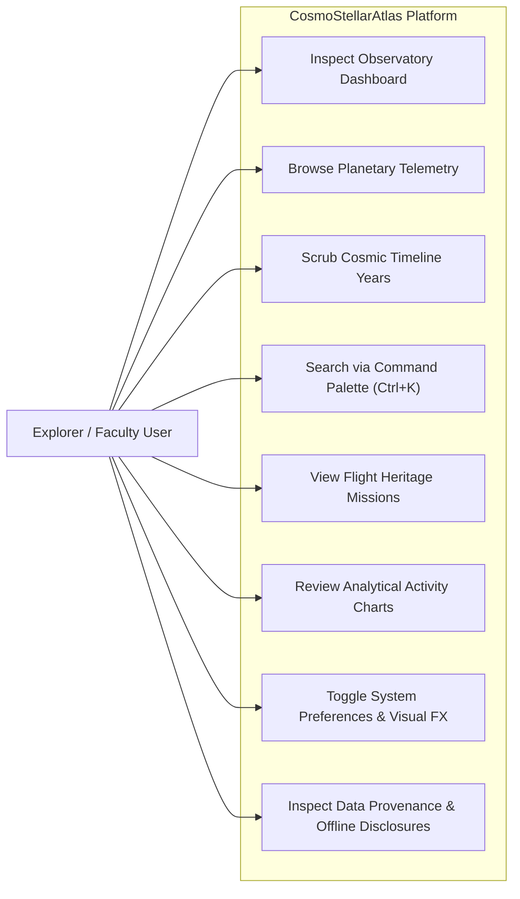
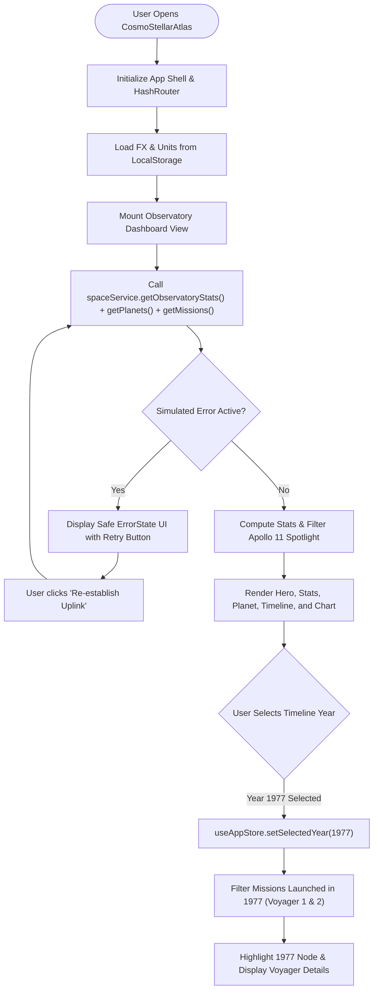
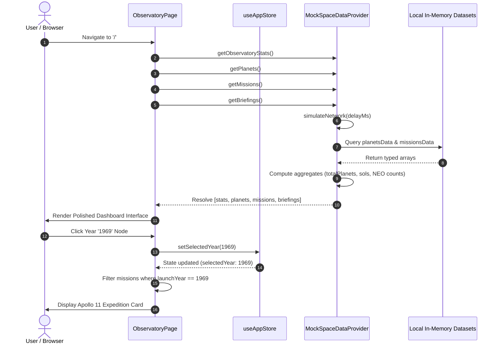
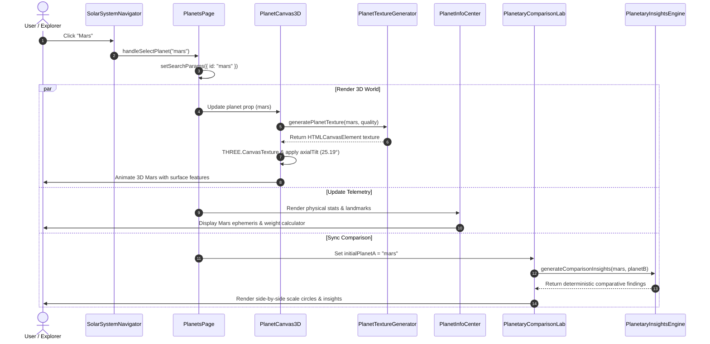

# System Design Diagrams & UML Models
## CosmoStellarAtlas — Open Space Exploration Portal
**Author:** Rufus Samuel R  
**Institution:** Karunya Institute of Technology and Sciences  

---

## 1. Use Case Model


---

## 2. Component Diagram
```mermaid
graph TD
    subgraph UI_Shell["UI & Layout Shell"]
        AppLayout["AppLayout"]
        Navbar["Navbar HUD"]
        Sidebar["Sidebar Navigation Array"]
        Footer["Footer & Attribution"]
        Starfield["Starfield Canvas"]
        Palette["Command Palette"]
    end

    subgraph Feature_Views["Observatory Views"]
        Hero["HeroSection (Celestial Centerpiece)"]
        Stats["StatsSection (4 Metric Cards)"]
        PlanetFeat["FeaturedPlanetSection"]
        MissionFeat["MissionSpotlightSection"]
        TimelinePrev["TimelinePreviewSection"]
        ChartFeat["MissionActivityChartSection"]
        ModulesGrid["DiscoveryModulesSection"]
    end

    subgraph State_Layer["State Management"]
        AppStore["useAppStore (Zustand)"]
        LocalStorage[("Browser LocalStorage")]
    end

    subgraph Service_Layer["Service Abstraction"]
        ProviderInterface["<<interface>> SpaceDataProvider"]
        MockProvider["MockSpaceDataProvider"]
    end

    subgraph Data_Layer["Local Datasets"]
        PlanetsDB[("planetsData")]
        MissionsDB[("missionsData")]
        RoversDB[("roversData")]
        AsteroidsDB[("asteroidsData")]
        LaunchesDB[("launchesData")]
    end

    AppLayout --> Navbar
    AppLayout --> Sidebar
    AppLayout --> Footer
    AppLayout --> Feature_Views

    Feature_Views --> AppStore
    Feature_Views --> ProviderInterface
    AppStore <--> LocalStorage

    ProviderInterface <|.. MockProvider
    MockProvider --> Data_Layer
```

---

## 3. Activity Diagram: Dashboard Initialization & Year Scrubbing


---

## 4. Sequence Diagram: Data Fetching & Local Provider Flow


---

## 5. Entity Relationship Diagram (ERD)
```mermaid
erDiagram
    PLANET ||--o{ MISSION : "associated with"
    MISSION ||--|{ MISSION_MILESTONE : "contains"
    ROVER ||--|{ ROVER_IMAGE : "captures"
    PLANET {
        string id PK
        string name
        string codeName
        int orderFromSun
        string type
        float diameterKm
        float distanceFromSunAU
        float surfaceTempMeanC
        float gravityEarthRel
        int moonsCount
        string source
    }
    MISSION {
        string id PK
        string name
        string agency
        int launchYear
        string launchDate
        string status
        string destinationPlanetId FK
        string destinationName
        string missionType
        string description
        string source
    }
    MISSION_MILESTONE {
        string id PK
        string missionId FK
        int year
        string date
        string title
        string description
        string significance
    }
    ROVER {
        string id PK
        string name
        string agency
        string landingDate
        string landingSite
        string status
        int totalSols
        float distanceTraveledKm
        int sampleCount
        string source
    }
    ROVER_IMAGE {
        string id PK
        int sol
        string cameraName
        string cameraFullName
        string earthDate
        string caption
    }
    ASTEROID {
        string id PK
        string name
        string designation
        float estimatedDiameterMeters
        boolean isPotentiallyHazardous
        string closeApproachDate
        float missDistanceKm
        float relativeVelocityKmS
        string orbitClass
        float simulatedRiskIndex
        string source
    }

---

## 6. Use Case Model: Phase 2 Planet Explorer & Comparison Lab
```mermaid
flowchart LR
    User["Explorer / Astronomer"]

    subgraph PlanetExplorer["Planet Explorer Module (/planets)"]
        UC_View3D["Inspect 3D Planetary World (WebGL)"]
        UC_2DFallback["Switch to Accessible 2D Canvas Fallback"]
        UC_Controls["Manipulate Drag Rotation & Zoom Controls"]
        UC_NavMode["Toggle Explore vs Solar Schematic Mode"]
        UC_Weight["Calculate Interactive Relative Earth Weight"]
        UC_Compare["Compare Two Worlds Side-by-Side"]
        UC_Insights["Generate Deterministic Comparative Insights"]
        UC_Scale["Analyze Solar System Logarithmic Scales"]
        UC_Missions["Review Historical Planetary Missions"]
        UC_Epoch["Filter Missions via Cosmic Time Machine Epoch"]
        UC_Passport["Traverse via Discovery Passport Highlight"]
    end

    User --> UC_View3D
    User --> UC_2DFallback
    User --> UC_Controls
    User --> UC_NavMode
    User --> UC_Weight
    User --> UC_Compare
    User --> UC_Insights
    User --> UC_Scale
    User --> UC_Missions
    User --> UC_Epoch
    User --> UC_Passport
```

---

## 7. Sequence Diagram: Planet Selection & Rendering Pipeline


---

## 8. Activity Diagram: Planetary Comparison & Insights Synthesis


```

